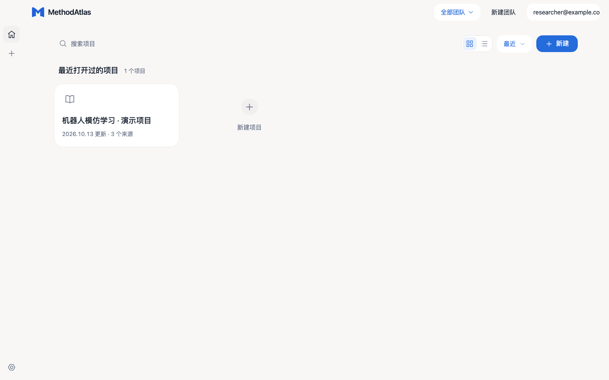
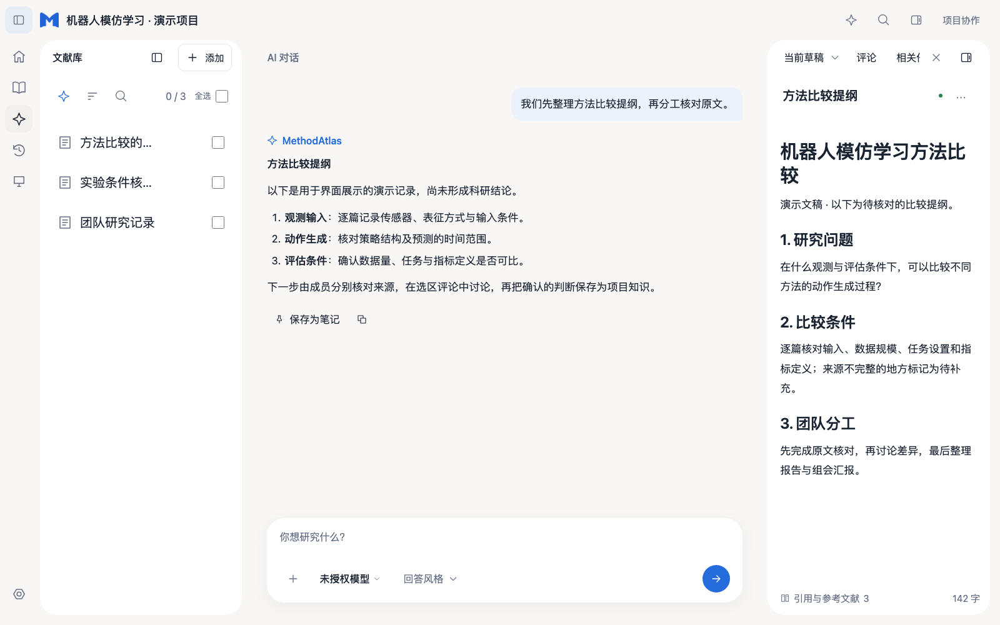
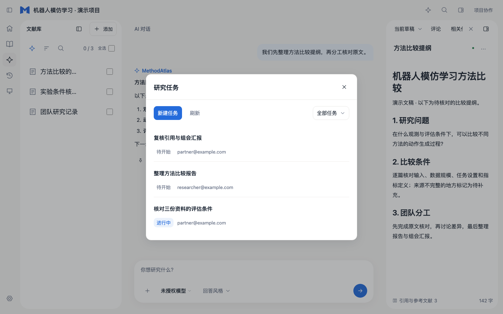

<p align="center"></p>

# MethodAtlas · 科研共脑

**让团队围绕同一份文献、同一个问题持续研究，结论有出处，成果有版本。**

论文、聊天记录、实验结果和文稿散在不同工具里时，成员很难接上彼此的研究。MethodAtlas 把这些内容放进研究项目：左侧组织资料，中间讨论与执行研究，右侧编辑和交付成果。个人可以完成一条研究流程，团队可以共享依据、分配任务、讨论原文并保留修改记录。

[在线体验](https://methodatlas.64-90-4-239.sslip.io/) · [评委体验路线](docs/example.md) · [使用说明](docs/usage.md) · [本地安装](docs/installation.md)

在线版使用邮箱验证码登录。登录后可以建立团队和项目，也可以接受绑定本人邮箱的项目邀请。具体演示项目由项目方提供；模型和服务器资源由团队配置并授权。





## 一条完整的研究流程

| 环节 | 当前版本的操作 |
| --- | --- |
| 收集与阅读 | 导入 PDF、论文链接或文字；组织文献分类，在连续正文、原 PDF、公式和图表之间核对。 |
| 提问与核对 | 围绕选中文献或原文片段提问；通过引用回到实际使用的资料版本。浮动对话支持完整历史、移动和调整大小。 |
| 整理与写作 | 生成综述、方法比较、图表、关系图谱或组会汇报；在论文编辑器审阅 AI 修改提案。 |
| 保存与交付 | 草稿自动保存，重要节点手动存档；按成果类型导出 Markdown、HTML、PDF、DOCX 或 PPTX。 |
| 团队继续研究 | 共享资料与对话，分配研究任务，围绕选区评论、回复与 @ 成员；把确认的结论保存为项目知识。 |

普通对话不会强制生成文件。全文未取得时只使用可获得的摘要或元数据，界面会提示资料状态。研究回答和图表需要结合原文、真实数据核对。

## 共同研究，也保留个人探索

项目是共享资料与成员访问的边界。团队成员只有加入项目后才能访问其中内容。研究对话默认共享，也可以开启私人探索；私人内容需主动发布共享副本，才进入项目知识。

研究任务记录负责人、状态、优先级和关联材料；AI 执行另有运行记录。论文及成果支持共享评论，文稿保存发生冲突时保留输入并提示处理。项目动态、通知与研究回顾帮助成员接续工作。



协作版支持共享文稿与版本管理。目前不提供多人光标或字符级实时合并；同时编辑时需要处理保存冲突。

## 本地运行

需要 Python 3.12、Node.js ≥ 22.18。本地默认个人模式，研究操作使用自己配置的模型连接。

```sh
git clone https://github.com/zcx28/MethodAtlas-showcase.git
cd MethodAtlas-showcase
python3.12 -m venv .venv
.venv/bin/python -m pip install -r requirements.txt
npm ci
npm run build:writing
.venv/bin/python -m backend.app
```

打开终端打印的地址，在「设置 → 模型连接」添加并测试连接。Windows、独立检索环境、多人认证与可选组件见[安装说明](docs/installation.md)。

## 评委先试这条路线

1. 打开演示项目，导入或选择两至三份同主题资料。
2. 比较方法，点击回答引用回查原文，再选中一段文字在浮窗中追问。
3. 生成比较报告，修订并导出；进入论文编辑器，验证草稿与手动存档。
4. 切换到另一位已邀请成员，查看共享内容、领取任务并回复一条评论。
5. 开启私人探索，核对其他成员无法读取；有需要时再主动发布共享笔记。

详细步骤与公开论文入口见[体验案例](docs/example.md)。本页截图来自当前界面，使用独立演示数据，不代表已完成的科研结论。操作以当前网站和说明为准。

## 源码与运行边界

```text
backend/          研究服务、认证与项目协作、资料和成果管理
prototype/        前端、阅读器、论文编辑器和静态资源
third_party/      实际使用的第三方模块、模板与许可证
docs/             安装、使用、体验路线与展示截图
```

[运行检查](docs/checks.md) · [依赖与第三方来源](docs/dependencies.md)

检索、模型生成、邮件、OCR、论文模板排版和远程实验分别依赖外部服务或可选环境，详见安装说明。仓库不包含账号凭据、真实研究数据或论文全文副本。
