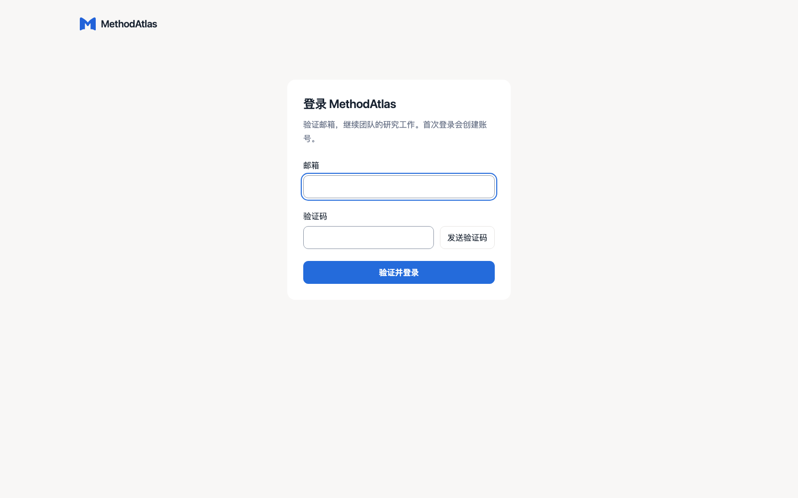

# 使用说明

## 进入个人或团队工作台

[在线版](https://methodatlas.64-90-4-239.sslip.io/)使用邮箱验证码登录。首次验证后创建账号；可以新建团队、建立项目，或接受绑定当前邮箱的项目邀请。团队管理模型与服务器资源，项目管理资料与成员访问。加入团队不会自动加入所有项目。

本地未配置认证服务时进入个人模式，不需要登录。数据与在线版分别保存。在设置中添加模型连接并测试能力；多人版由负责人配置团队连接并授权给项目，普通成员不能读取连接密钥。

## 收集与阅读资料

新建研究项目，点击添加来源，上传 PDF、粘贴论文链接或输入原文文字。导入结果逐项显示，资料可以按主题分类并手动调整；删除分类不删除文献。来源未提供可访问全文时，只有摘要或元数据，可以补充自己取得的 PDF。

点击资料进入连续正文阅读；需要核对版面、公式或图像时切换原 PDF。段落翻译、解释、重点和个人批注作为阅读辅助保存，不会改写原文。选中文本可追加引用到研究对话。

勾选资料表示当前研究重点。“仅这些”限制研究范围；未限定时可使用当前有权访问的项目资料。

## 主对话与浮动对话

可以比较方法、解释段落、查找依据，或明确要求生成成果。普通讨论不会自动生成文件，空白新对话不会仅因打开窗口就新增已保存会话。

点击回答引用回到所用文献版本的对应位置。阅读时可打开 AI 对话浮窗：拖动标题栏移动，使用窗口边缘调整大小；历史入口单独展示当前项目的会话列表，选中后返回完整对话。连续选区追加到当前所选会话，发送后才执行。关闭浮窗不停止已经发起的任务。

多人项目中的对话默认共享，也可以新建私人探索。私人对话及其衍生成果不会自动进入其他成员的搜索、项目问答或回顾。发布共享笔记前先预览；发布的是独立副本，原内容仍为私人。

## 文稿、提案与成果版本

明确要求：“把这些资料整理成方法比较报告，保留引用。”右侧成果区可预览、修订并下载，导出格式以对应成果的按钮为准。

论文编辑器的当前草稿自动保存。AI 起草、润色或回应审稿意见会生成修改提案，用户审阅并接受后更新草稿。手动存档才追加成果历史；内容未变不会重复存档。恢复历史版本会先确认替换当前草稿，导出和排版不会自动制造新存档。

共享文稿不提供多人光标。两人同时修改发生保存冲突时，界面保留未保存输入，先查看最新内容再合并。已有成果与资料版本保留实际引用依据，后续更改不改写过去的研究记录。

图表需要真实 CSV 或结构化数据；关系图谱可导出独立 HTML；组会汇报支持 PPTX。论文一键排版需要安装 Typst 和可用字体。

## 团队分工与讨论

在项目内打开「项目协作」：

- **成员与邀请**：负责人邀请、移除成员或转移项目所有权。邀请绑定邮箱，有有效期并可撤销。
- **研究任务**：设置标题、负责人、状态、优先级、截止日期，关联文献、成果、实验或 AI 运行。研究任务与一次 AI 执行是两种记录。
- **共享评论**：对论文或文稿选区评论，回复、@ 成员，解决或重新打开讨论。定位失效时保留原引用并标记原文已变更。
- **项目知识**：保存经成员确认的结论，保留来源；新的判断可以关联过去的记录。
- **项目动态与通知**：查看成员活动、任务分配和评论提及；邮件提醒需配置发送服务，并由成员选择订阅。

移除成员后撤销后续项目访问，已共享的贡献仍保留作者。负责人不能读取他人的私人正文。

## 持续研究与远程实验

个人研究方法可以从已完成回答中提炼，预览确认后保存复用。论文订阅定时检索，候选资料确认后进入项目。研究回顾按项目时区整理日、周、月的实际活动，人工修订保留。

自动任务需要后端持续运行；模型、网络和来源可用性会影响结果。远程实验另需配置服务器、目录与权限，核对计划和授权范围后执行，日志及选定结果可以回收为研究材料。隔离实验组要求远端具备可用的 bubblewrap。

## 检查一次交付

导入资料 → 提问 → 点击引用 → 生成成果 → 修订 → 下载。确认文件可打开，引用指向当时使用的版本。协作体验再增加：邀请成员 → 分配任务 → 回复评论 → 验证私人内容的访问边界。
